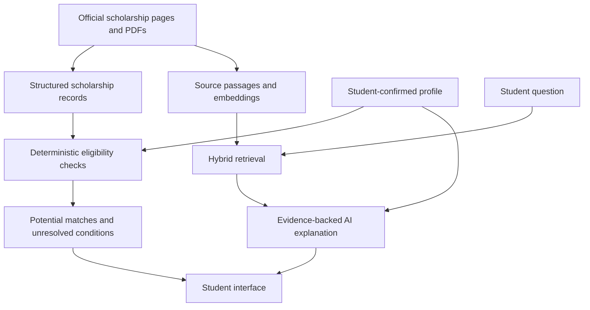

# NextStep Scholarships

**Designing scholarship discovery around evidence and uncertainty**

**Role:** Product owner, working with Codex as an AI implementation partner  
**Scope:** Public course demo for Georgia high-school juniors and seniors  
[Live demo](https://nextstep-scholarships.replit.app/) · [GitHub repository](https://github.com/dsilvadeepal/nextstep-scholarships)

## The problem

A student may know their GPA, interests, and prospective colleges but still struggle to decide which scholarships deserve attention. Requirements can be spread across application pages, FAQs, and PDFs. Missing information makes a confident recommendation particularly risky.

NextStep explores a product hypothesis: a short profile, explained potential matches, visible evidence, and practical next steps can make scholarship discovery more actionable than a list of links. This hypothesis has not yet been validated through student research.

## My contribution

I owned the product direction and reviewed the experience and release scope, working with Codex on implementation and testing. My contribution centered on defining the audience, shaping the discovery journey, setting boundaries for provisional guidance, and reviewing the working demo.

AI-assisted development supported the build. The repository documents the requirements, technical design, evaluation results, and known limitations so the decisions can be inspected alongside the code.

## Key product decisions

| Decision | Reasoning |
| --- | --- |
| **Start with a short, skippable profile.** | Let students explore with the information they have. Keep additional details optional and provide fictional profiles for trying the demo. |
| **Separate eligibility checks from AI explanations.** | Use structured rules to distinguish conditions that are met, unmet, or unknown. Use retrieved evidence to support conversational explanations. |
| **Preserve the meaning of student inputs.** | Considering a college does not establish admission or enrollment. An estimated GPA does not establish the institution’s required GPA calculation. |
| **Make uncertainty actionable.** | Show unresolved conditions and source links so students know what to confirm next. Avoid invented eligibility percentages or award predictions. |
| **Keep the release focused on discovery and preparation.** | Support shortlisting, comparisons, and printable plans. Defer application automation, essay generation, and persistent student accounts. |

## What shipped

A responsive Replit-hosted demo with guided intake, grouped potential matches, cited conversation, source inspection, and printable preparation plans. The documented release contains **39 award records across 31 award families**, supported by **63 official documents**.

The system combines structured matching with retrieval-augmented generation: it retrieves relevant source passages before generating an explanation.

## How the system works

The React and TypeScript interface talks to a FastAPI backend. PostgreSQL stores the structured scholarship catalog and evaluation records; Pinecone stores vectors used to find relevant source passages. Replit hosts the student experience, while admin evaluations remain local.

**Two complementary paths support the experience:**

- **Matching:** Explicit rules compare the confirmed student profile with structured requirements. Each condition remains `met`, `unmet`, or `unknown`, so a missing detail does not silently become a qualification. This path depends on the quality of the extracted rules as well as the student’s inputs.
- **Answering questions:** Official source text is split into passages, preserving document structure where possible. OpenAI embeddings represent those passages as vectors for semantic search. The app combines Pinecone semantic results with BM25 keyword results using equal-weight reciprocal-rank fusion—a method that combines the two ranked lists. Semantic search helps with differently worded questions; keyword search helps retain exact scholarship names and terms.

The answer context is limited to **eight passages and 5,000 tokens**. `gpt-4.1-mini` produces structured explanations tied to source IDs, followed by a bounded support review. Citation checks and model review help catch errors, but do not guarantee that every interpretation is correct. LangChain supports splitting and model-call composition; the application follows a bounded workflow without an autonomous agent loop.

## Technical trade-offs

Keeping structured matching separate from answer generation makes eligibility decisions easier to inspect. Bounding the retrieved context limits how much evidence enters each answer, but makes passage selection important: a relevant document can still omit the decisive requirement from the selected context.

In a five-case development comparison, targeted passage selection recovered a missing scholarship score threshold. That improvement supported the design, while remaining a small, exposed regression result rather than evidence of general accuracy. A separate 60/40 semantic–keyword experiment completed 25 of 26 cases and did not justify replacing the equal-weight hybrid default. These experiments informed the configuration without establishing that hybrid retrieval is universally better.

## Evaluation and limitations

Testing exposed a wrong-program substitution when requested scholarship evidence was missing. A coverage guard was added, and the failure became a regression case.

The historical 26-case development suite passed for both semantic and equal-weight hybrid retrieval. These were exposed tuning cases, **not an independent accuracy estimate**. The repository also preserves failures and distinguishes rescoring saved answers from running new evaluations.

The project demonstrates a working discovery flow and documented technical checks. It does not yet establish student adoption, time savings, or improved scholarship outcomes.

## Next step

Test whether students can identify an opportunity worth investigating, explain an unresolved requirement, and leave with a concrete preparation step. Use those observations to improve the experience before expanding its scope.

*Sources: [Product requirements](../PRD.md), [release status](BUILD_STATUS.md), [evaluation report](EVAL_REPORT.md), [retrieval comparison](RAG_COMPARISON_2026-10-15.md), [architecture and pipeline](../README.md#how-the-rag-pipeline-works).*
